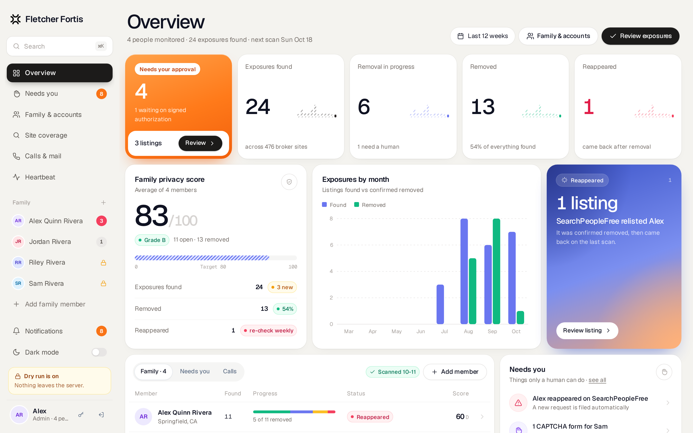
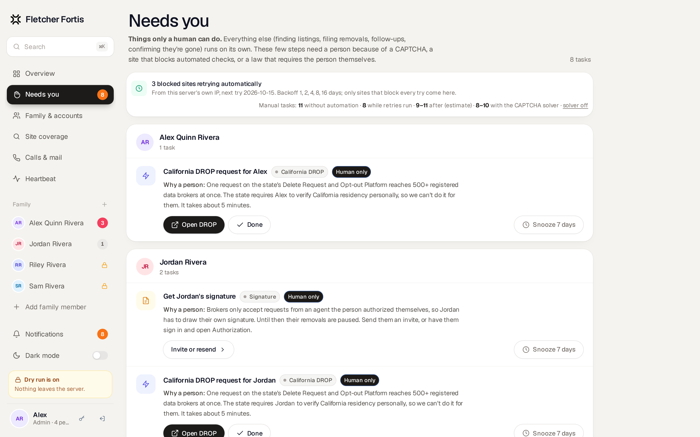
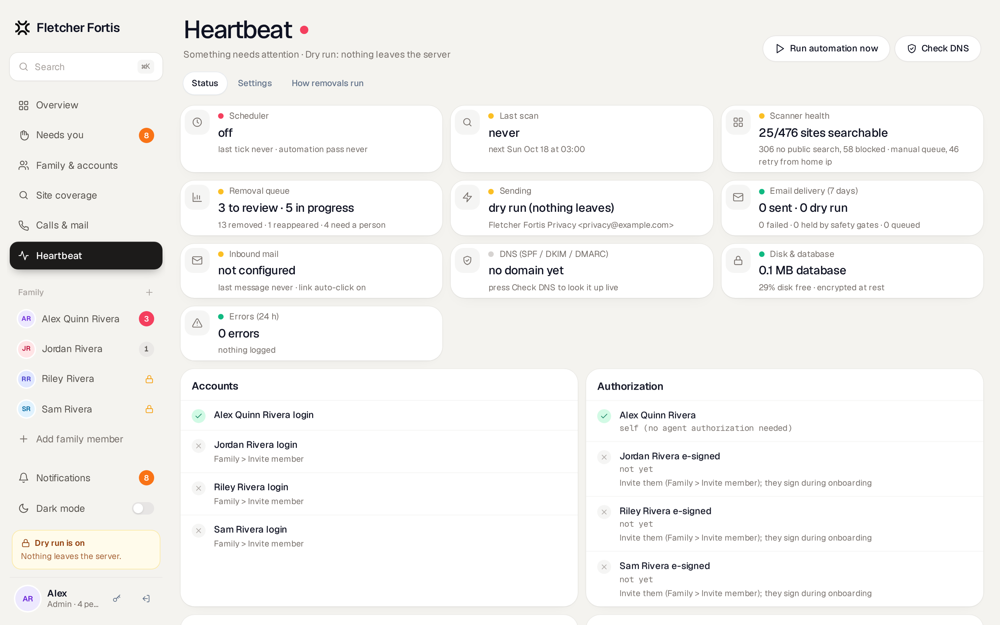

# Fletcher Fortis

**Get your family off people-search sites, and keep them off. Self-hosted, one container.**

Fletcher Fortis searches 430+ people-search and data-broker sites for each person in your family. It files the removal requests, follows up when brokers go quiet, confirms each listing is actually gone, and checks again every week. You run it on your own hardware or a $5 server. Names, addresses and phone numbers stay encrypted in your own database, not with another data company.



<p align="center"><a href="#getting-started">Getting started</a> · <a href="#how-it-works">How it works</a> · <a href="#security-model">Security</a> · <a href="#faq">FAQ</a> · <a href="https://fletcher-fortis.github.io/fletcher-fortis/">Website</a></p>

## Why

Commercial removal services charge $100–$250 per person per year and need your full profile on their servers to do the work. For a family of four that's up to $1,000 a year, plus one more company holding exactly the data you're trying to remove.

Most of that work is mechanical: search, match, send the right legal request, wait, check again. Fletcher Fortis automates the mechanical part and gives you a short list of the few steps that need a person.

## Features

**Scan**
- Searches 430+ people-search sites per person using every name, nickname, former city and phone you add.
- Scores each match from 0 to 100 on name, age range, city and relatives, and keeps a screenshot as evidence.
- Shows which sites answer, which block automated searches, and which are dead (Site coverage).

**Remove**
- Picks the best channel per broker: parent-company suppression (one request covers every sister site), the opt-out web form, or a privacy email.
- Writes each email for the person's state: CCPA/CPRA and the Delete Act in California, 19 other state privacy laws, and a generic fallback. Requests list only the data that broker showed and set the legal response deadline.
- Acts as an authorized agent, with the person's signed authorization attached. Family members draw their own signature during onboarding.
- Clicks broker verification links automatically when inbound mail is set up.
- Learns which channel actually gets listings removed for each broker and prefers it next time.

**Monitor**
- Sends a reminder on day 20 and an escalation on day 45 that cites the regulator.
- Re-scans to confirm a listing is gone before marking it Removed.
- Re-checks every week and re-files automatically if a listing comes back.
- Sends each member a short weekly email; the admin gets the family view.
- Inbox: every email sent and received (requests, follow-ups, broker replies, verification emails, digests) in one list with status tabs, filters, search and a thread view per request.

**Needs you**
- Steps a person has to do are collected on one page, grouped by person, each with the reason in plain language and buttons to open the site, mark it done, or snooze it.
- Sites that block the search are retried automatically from your server's own IP, with backoff (1, 2, 4, 8 and 16 days), before they land on that page.
- Optional CAPTCHA solving through 2Captcha or CapSolver with a monthly budget cap. Off by default.
- Steps that legally or practically need the person are marked **Human only**: California DROP residency verification, the person's own signature, photo-ID uploads and phone-only opt-outs.



## How it works

Every listing moves through the same lifecycle. Each step runs on its own unless it's marked otherwise.

| Step | What happens |
|---|---|
| **Scan** | Weekly, and right after a profile changes. Headless Chromium, one site at a time, with a polite delay. |
| **Match** | Name, age range, city and relatives are scored 0–100. Low scores are shown but never acted on. |
| **Approve** | The person or the admin approves the match. Optionally, matches above a score you choose are approved automatically. |
| **Channel** | Parent suppression, then web form, then privacy email, ranked by what has worked for that broker before. |
| **Submit** | Sent from your domain. While dry run is on, requests are written and stored but nothing leaves the server. |
| **Verify** | Broker "confirm your request" emails arrive in the agent inbox and their links are opened automatically. |
| **Follow up** | Reminder on day 20, escalation on day 45. |
| **Confirm** | A re-scan shows the page is gone. The listing is marked Removed. |
| **Watch** | Re-checked weekly. If it reappears, a new request is filed. |

California residents also get one task for the state's [Delete Request and Opt-out Platform](https://privacy.ca.gov/drop/) (DROP). A single request there reaches every registered data broker in the state, but the person has to verify residency on the state's site.

## Getting started

**What you need**
- A machine with Docker and Compose: a home server, NAS, Raspberry Pi 4/5 (4 GB) or a $5 VPS. About 1 GB of RAM.
- *Optional:* a domain, if you want to reach the app from outside your network and send requests from your own address.
- *Optional:* a free [Resend](https://resend.com) account for sending, and Cloudflare Email Routing (free) for broker replies. You can add both later.

**Steps**
1. Start it:
   ```bash
   git clone https://github.com/deanayoung3-droid/fletcher-fortis.git && cd fletcher-fortis
   docker compose up -d
   ```
2. Find the one-time setup link in the logs:
   ```bash
   docker compose logs app | grep "Setup URL"
   #  Setup URL: http://localhost:8080/setup?token=...
   ```
   In Portainer: **Containers → app → Logs**. Use your server's address instead of `localhost` if you're on another machine. The link works only until the admin account exists, and a new one is printed on every restart. Without the token, `/setup` only shows where to find it, so nobody else on your network can claim the install.
3. Follow the setup wizard. Every step can be revisited later, and everything is stored (encrypted) in the database and editable in **Heartbeat → Settings**:
   1. **Admin account:** name, username, email and a password (12+ characters, with a strength meter).
   2. **Basics:** app name, public URL, time zone, and your state of residence (it picks the privacy law cited in requests).
   3. **Email sending** *(optional)*: Resend API key and from address, with a **Send test email** button. Dry run stays on.
   4. **Inbound replies** *(optional)*: Cloudflare Email Worker steps, with the worker code, URL and a generated secret ready to copy.
   5. **Optional keys:** CAPTCHA solver, update channel and automatic updates.
   6. **First person** *(optional)*: add yourself so the first scan has something to look for.
   7. **Done:** a checklist of what's configured and what's left. The dashboard keeps a *Setup checklist* card until it's complete.
4. **Save the encryption key.** If you didn't set `FF_DATA_KEY`, the app generates one on first boot in `/data/secrets/ff_data_key` and shows it on the Done screen. Keep a copy in your password manager; without it the encrypted data can't be recovered. For stronger protection, set it yourself before step 1:
   ```bash
   echo "FF_DATA_KEY=$(openssl rand -base64 32)" > .env && docker compose up -d
   ```
5. Look around. Dry run is on, so you can run scans and read the generated requests without anything being sent. Switch it off in Heartbeat when you're ready (it asks you to type `LIVE`).

Already running an older version? Nothing changes: installs that have an admin (or set `ADMIN_USERNAME`/`ADMIN_PASSWORD`) skip the wizard. `ADMIN_PASSWORD` still works as a way to create the admin without the wizard.

## Running it on a home server

A home server is the best place for it. People-search sites block datacenter IP ranges far more often than home connections, so more sites can be checked automatically.

- **Image:** `ghcr.io/deanayoung3-droid/fletcher-fortis:latest` (amd64 + arm64). Updating, backups and the optional Watchtower sidecar: see [Updating](docs/SELF-HOSTING.md#updating).
- **Portainer:** Stacks → Add stack → paste [`deploy/portainer-stack.yml`](deploy/portainer-stack.yml), and fill in the variables from [`deploy/stack.env.example`](deploy/stack.env.example). The only required one is `FF_DATA_KEY`.
- **Remote access:** use Cloudflare Tunnel. You don't need open ports or a public home IP.
- Step-by-step guide: [docs/SELF-HOSTING.md](docs/SELF-HOSTING.md).

It needs about 1 GB of RAM (Chromium) and a few hundred MB of disk. A Raspberry Pi 4/5 with 4 GB, an old laptop or a NAS that runs Docker is enough.

## Running it in the cloud

| Where | Cost | Notes |
|---|---|---|
| Hetzner, DigitalOcean, Vultr or Linode VM | ~$5/month | 2 GB RAM, Ubuntu. `DOMAIN=privacy.example.com docker compose --profile https up -d` gets a certificate through the bundled Caddy. |
| Fly.io | ~$5/month | `fly launch`, a 1 GB volume at `/data`, `FF_DATA_KEY` as a secret. |
| Railway | usage-based | Deploy from the repo, add a volume at `/data`, set `FF_DATA_KEY`. |

Commands for each: [docs/CLOUD.md](docs/CLOUD.md). Datacenter IPs are blocked by more sites. Site coverage shows which ones, and an optional `PROXY_URL` lets you route searches through a residential proxy you already have.

## Configuration

You don't edit any code or config files. Everything lives in the app:

- **Setup wizard (first run):** admin account, basics, email, inbound replies, optional keys, first person. See [Getting started](#getting-started).
- **Heartbeat → Settings:** every other option. Values are stored encrypted in the database, take effect without a restart, and override environment variables. Secrets are write-only.

| Group | Settings |
|---|---|
| Branding | App name, accent color, logo |
| Household | Time zone, state of residence |
| Domain | Public URL, email domain |
| Email | Resend API key, from address and name, inbound webhook secret, auto-click verification links, weekly summaries |
| Scanning | Weekly scan day and hour, delay between requests, searches per site |
| Removals | Auto-approve and its minimum score, re-file when a listing reappears, reminder and escalation days, blind requests to blocked sites (off) |
| Automation | Retry blocked sites, auto re-check, CAPTCHA solver provider, API key and monthly budget (off) |
| Updates | Update channel (stable or beta), automatic installs, Watchtower token |
| Safety | Dry run. Turning it off requires typing `LIVE`. |

Heartbeat also shows the health of everything that runs on its own: scheduler, scanner, send queue, delivery, inbound mail, DNS records, disk and recent errors.



## Email setup

Removal requests go out from your own domain, and replies come back to the app.

**Sending ([Resend](https://resend.com), the free tier is enough for a family)**
1. Add your domain in Resend. Add the SPF, DKIM and DMARC records it lists, at your DNS provider.
2. Create an API key with send access.
3. In Heartbeat → Settings → Email, paste the key and set the from address (for example `privacy@yourdomain.com`).
4. Click **Check DNS** in Heartbeat. All three records should show OK.

**Receiving (Cloudflare Email Routing, free)**
1. In Cloudflare, turn on Email Routing for the domain. Cloudflare adds the MX records.
2. Deploy [`deploy/cloudflare-email-worker.js`](deploy/cloudflare-email-worker.js) as an Email Worker. Set `APP_URL` to `https://your-app/inbound/email` and the secret `INBOUND_SECRET` to the same value as in Heartbeat.
3. Route `privacy@yourdomain.com` (or a catch-all) to the worker.

Broker replies then appear on the listing, and verification links are opened automatically. Mail that isn't from a known broker is ignored.

## Security model

Fletcher Fortis holds the data it's trying to protect, so it's built to leak as little as possible if something goes wrong.

- **Encrypted at rest.** Every personal field is encrypted with AES-256-SIV under a key you supply: names, addresses, phones, emails, listing URLs, request bodies and inbound mail. A copy of the volume without the key is unreadable.
- **No identity documents.** The app refuses Social Security numbers, full dates of birth and ID numbers. Nothing in the schema can store them.
- **Locked-down container.** Runs as uid 10001 with a read-only root filesystem, `cap_drop: ALL` and `no-new-privileges`. Only `/data` is writable.
- **Web hardening.** Server-side sessions, bcrypt passwords and login rate limiting. CSRF tokens on every form. A strict Content-Security-Policy with no inline scripts. HSTS and `X-Frame-Options: DENY`.
- **Least privilege inside the family.** Members see and edit only their own profile and listings. Only the admin can turn sending on.
- **Safe by default.** Dry run is on until you switch it off. Blind requests and the CAPTCHA solver are off.
- **No telemetry.** The app contacts broker sites, your email provider and, if you turn it on, your CAPTCHA provider. Nothing else.

Full details and the threat model: [SECURITY.md](SECURITY.md). To report a vulnerability, open a private security advisory on GitHub rather than a public issue.

## Legal note: acting as an authorized agent

U.S. state privacy laws let a person delegate a deletion or opt-out request to an authorized agent. Fletcher Fortis sends requests in that role, and only for people who signed the authorization themselves: drawn signature and typed name, recorded with time and IP under E-SIGN/UETA.

- Use it for yourself and family members who agree to it. A parent or guardian can act for a minor.
- It never impersonates anyone and never sends more verification than the law requires.
- If you turn on the optional CAPTCHA solver, you're responsible for whether that fits the site's terms.
- Laws differ by state and change often. This project is not legal advice.

## FAQ

**Does this actually remove listings?**
For sites that honor opt-outs, yes. Each removal is confirmed by a re-scan, not assumed. Some sites relist people after a few months, which is why the weekly re-check and automatic re-filing exist.

**How much of my time does it take?**
Setup takes about 15 minutes. After that, mostly the Needs you page. Expect California DROP once per person, a signature per family member, and a handful of sites that block every automated check. The page shows a forecast of how many tasks to expect with each automation on.

**Why not just use a paid service?**
If you'd rather not run a server, a paid service is a reasonable choice. Fletcher Fortis is for people who want to see every request that's sent, keep the data at home, and not pay per person.

**Will brokers know it's automated?**
Requests come from your domain, signed by you as the authorized agent, and cite the relevant law. Automated or not, brokers covered by these laws have to process valid requests.

**Can I use it for people who aren't my family?**
Only with their signed authorization, which they give themselves through the onboarding link. The app isn't built for running a removal business.

**What happens if I lose the encryption key?**
The encrypted fields can't be recovered. Store `FF_DATA_KEY` in a password manager and back up the `/data` volume separately.

**Which sites are covered?**
See Site coverage in the app, or [`optout/sites.yaml`](optout/sites.yaml). Each site records how to search it, how to opt out, and its last measured health.

## Roadmap

- [ ] More hand-tuned search definitions for sites that only answer from home IPs
- [ ] Data-broker coverage beyond people-search (marketing lists, location data) through the state registries
- [ ] Encrypted backup to S3-compatible storage
- [ ] Optional passkey sign-in
- [ ] Translations

Ideas and votes are welcome in [Discussions](https://github.com/deanayoung3-droid/fletcher-fortis/discussions).

## Contributing

Bug reports, site definitions and fixes are welcome.

```bash
pip install -r requirements.txt pytest httpx
bash test/run-tests.sh                     # unit and integration tests (local mock sites only)
cd ui && npx tailwindcss@3 -c tailwind.config.js -i input.css -o ../optout/static/app.css --minify
```

- **Site definitions** live in `optout/sites.hand.yaml` (hand-tuned, wins over generated data). Include a search URL template, the not-found signal and the opt-out method.
- **Tests never contact real brokers.** Use the mock sites in `test/mock/`.
- Keep pull requests small and describe how you tested them.
- Don't add fields for SSNs, dates of birth or ID numbers. These will be declined.

## License

MIT. See [LICENSE](LICENSE). Bundled third-party components and their licenses are listed in [THIRD_PARTY.md](THIRD_PARTY.md).
